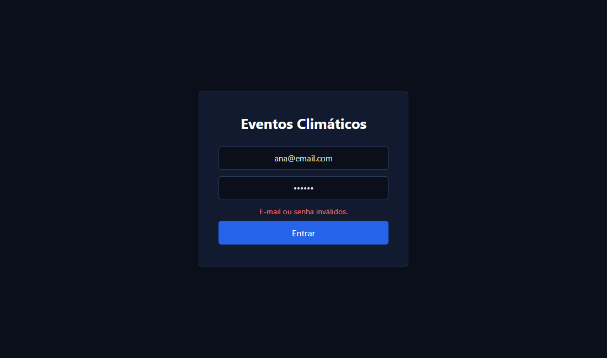
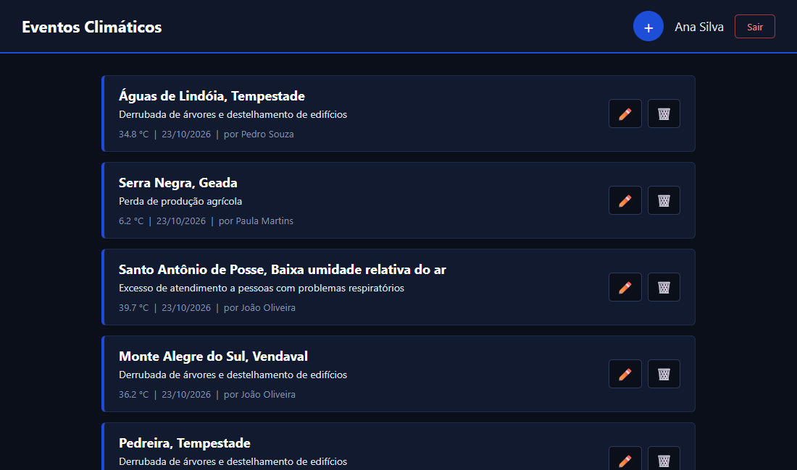
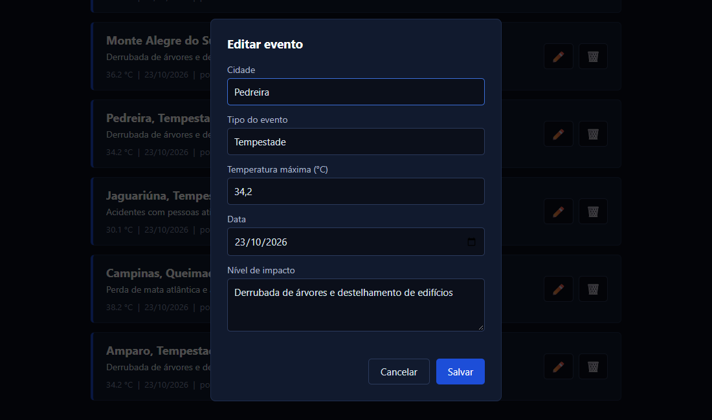
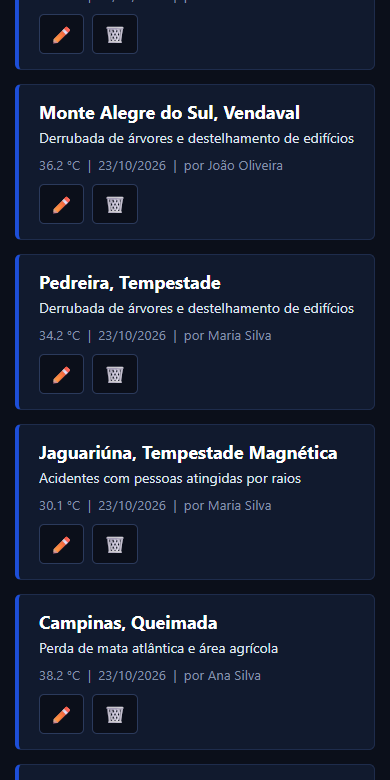

# Eventos Climáticos

Sistema full stack para **registro de eventos climáticos extremos** (tempestades, queimadas, geadas, vendavais...).
Projeto da **Aula 05 – Recursos Avançados – Prisma Seed**, com a Situação de Aprendizagem de front-end.

- **Back-end** (`/api`): API REST em Node.js + Express + Prisma ORM 7 + MySQL/MariaDB, com dados de teste (seed).
- **Front-end** (`/web`): HTML, CSS e JavaScript puro, consumindo a API com `fetch`.

## Documentação

| MER / DER conceitual | Diagrama de classes (UML) |
|---|---|
|  |  |

Wireframes:


## Telas desenvolvidas

| Login | Home |
|---|---|
|  |  |

| Cadastro / edição | Celular |
|---|---|
|  |  |

## Requisitos funcionais

| Código | Requisito | Situação |
|---|---|---|
| RF001 | Tela de login validando os usuários cadastrados | ✅ `web/index.html` |
| RF001.1 | Controller e rota **POST** de login que devolve os dados do usuário | ✅ `POST /usuario/login` |
| RF002 | Tela Home | ✅ `web/home.html` |
| RF002.1 | Nome do usuário logado no header da Home | ✅ |
| RF002.2 | Botão "Sair" no header da Home | ✅ |
| RF002.3 | CRUD de eventos climáticos | ✅ cadastrar, listar, editar e excluir |

Extras: rota `/evento/resumo`, Home bloqueada sem login e layout que funciona no celular.

## Tecnologias

- Node.js, Express, CORS, dotenv, nodemon
- Prisma ORM 7 com `@prisma/adapter-mariadb` (no Prisma 7 o driver adapter é obrigatório)
- MySQL / MariaDB (XAMPP)
- HTML5, CSS3, JavaScript (ES6+), `fetch` e `localStorage`
- VS Code, Insomnia, Git e GitHub

## Estrutura de pastas

```
eventos/
├── api/
│   ├── prisma/
│   │   ├── schema.prisma        # models Usuario e Evento
│   │   └── seed.js              # dados de teste
│   ├── src/
│   │   ├── controllers/         # usuario.controller.js, evento.controller.js
│   │   ├── data/prisma.js       # PrismaClient + adapter MariaDB
│   │   └── routes/              # usuario.routes.js, evento.routes.js
│   ├── .env                     # PORT e DATABASE_URL (não vai para o GitHub)
│   ├── prisma.config.ts         # schema, migrations, seed e datasource
│   ├── package.json
│   └── server.js
├── web/
│   ├── css/style.css
│   ├── js/
│   │   ├── api.js               # endereço da API, fetch e sessão
│   │   ├── login.js
│   │   └── home.js              # CRUD
│   ├── index.html               # tela de login
│   └── home.html                # tela home
└── docs/                        # diagramas e prints
```

## Como executar

### Pré-requisitos

- Node.js 20.19 ou superior
- XAMPP (MySQL/MariaDB) com o MySQL iniciado no Control Panel
- VS Code com a extensão **Live Server** (para o front-end)

### 1. Back-end

```bash
cd api
npm install
```

Confira o arquivo `.env` (se não existir, copie o `.env.example`):

```env
PORT=3000
DATABASE_URL="mysql://root@localhost:3306/eventos"
```

Crie o banco, as tabelas e os dados de teste:

```bash
npx prisma generate
npx prisma migrate dev --name init
npx prisma db seed
```

Inicie a API:

```bash
npm run dev
```

A API responde em `http://localhost:3000`.

### 2. Front-end

Abra a pasta `web` no VS Code, clique com o botão direito em `index.html` e escolha **Open with Live Server**.

Se a API estiver em outra porta, altere `API_URL` em `web/js/api.js`.

### Usuários de teste (seed)

| Nome | E-mail | Senha |
|---|---|---|
| Ana Silva | ana@email.com | senha123 |
| Maria Silva | maria@email.com | senha123 |
| João Oliveira | joao@email.com | senha123 |
| Paula Martins | paula@email.com | senha123 |
| Pedro Souza | pedro@email.com | senha123 |

### Reimplantar o banco de dados

Exclua a pasta `api/prisma/migrations` e rode:

```bash
npx prisma migrate reset
npx prisma migrate dev --name init
npx prisma db seed
```

> No Prisma 7 o `migrate dev` não roda o seed automaticamente, por isso o `npx prisma db seed` é sempre executado à parte.

## Endpoints da API

### Usuário

| Método | Rota | Descrição |
|---|---|---|
| POST | `/usuario/login` | Login. Corpo: `{ "email", "senha" }`. Devolve o usuário sem a senha |
| POST | `/usuario` | Cadastrar usuário |
| GET | `/usuario` | Listar usuários |
| GET | `/usuario/:id` | Buscar usuário com seus eventos |
| PUT / PATCH | `/usuario/:id` | Alterar usuário |
| DELETE | `/usuario/:id` | Excluir usuário (e os eventos dele) |

### Evento

| Método | Rota | Descrição |
|---|---|---|
| POST | `/evento` | Cadastrar evento |
| GET | `/evento` | Listar eventos (aceita `?usuarioId=1`) |
| GET | `/evento/resumo` | Total e quantidade/temperatura média por tipo |
| GET | `/evento/:id` | Buscar evento |
| PUT / PATCH | `/evento/:id` | Alterar evento |
| DELETE | `/evento/:id` | Excluir evento |

Exemplo de login:

```http
POST http://localhost:3000/usuario/login
Content-Type: application/json

{ "email": "ana@email.com", "senha": "senha123" }
```

Resposta `200`:

```json
{ "id": 1, "nome": "Ana Silva", "email": "ana@email.com" }
```

Com e-mail ou senha errados a resposta é `401` com `{ "erro": "E-mail ou senha inválidos." }`.

Exemplo de cadastro de evento:

```json
{
  "usuarioId": 1,
  "cidade": "Itatiba",
  "tipoEvento": "Granizo",
  "temperaturaMaxima": 27.5,
  "data": "2026-10-23T16:30:00.000Z",
  "nivelImpacto": "Danos em telhados e veículos"
}
```

## Observações técnicas

- **Seed reexecutável:** o `deleteMany()` não zera o auto incremento do MySQL. Por isso o `seed.js` usa o `id` real de cada usuário criado em vez de `usuarioId: 1, 2, 3...` fixos; assim ele pode ser rodado várias vezes sem erro de chave estrangeira.
- **Senha:** a API nunca devolve o campo `senha`. As senhas estão em texto puro por ser um projeto didático; em produção usaríamos `bcrypt` e um token (JWT).
- **Segurança no front:** os textos vindos da API são escapados antes de ir para o HTML (proteção contra XSS).

## Autor

Matheus Guilherme
